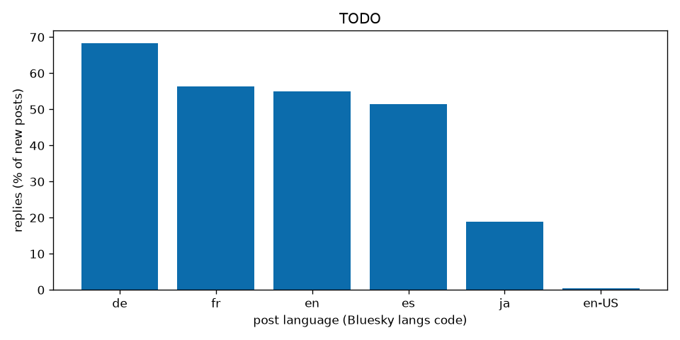

# Bluesky Replies by Language

**Author:** Seble Bedassa
**DS 3022 Data Project 3, Fall 2026**

## Data source
Source and URL: Bluesky Jetstream, `wss://jetstream2.us-east.bsky.network/subscribe?wantedCollections=app.bsky.feed.post`
Method: WebSocket push (server sends posts to you)
No account or API key, but User-Agent used 
No account or API key, but you send a User-Agent header.
One message: did (account id), time_us (event time in microseconds), kind, and commit with operation (create/update/delete), rkey (post id) and record (text, langs, and reply).
Live stream, not an archive replay.

## How to run
From a fresh clone:
`
git clone
cd ds3022-streaming
python3 -m venv .venv
source .venv/bin/activate
pip install --only-binary cryptography -r requirements.txt

# quick check, no Kafka needed
python flow.py data/sample

# full pipeline
docker compose up -d                                          # 3 brokers + console at http://127.0.0.1:8080
docker exec -it redpanda-0 rpk topic create bluesky_posts -p 3 -r 3
python producer.py                                            # terminal 1, leave running
python lander.py                                              # terminal 2, writes data/raw/*.parquet
prefect config set PREFECT_API_URL=http://127.0.0.1:4200/api
prefect server start                                          # terminal 3
python flow.py`                                                

## Architecture

_(replace: a diagram (an image in docs/ or a text diagram) of producer → topic → lander → raw Parquet → flow tasks → tables → charts, with the names of your files, topic, tables and charts.)_

## Design decisions
- Some posts appear more than once. A post can arrive as a create and later a delete or an update, all with the same did + rkey. They're 2 messages but 1 post. Same thing, different Kafka records.
  
Answer each in 2-4 sentences, in your own words, with your own numbers.

1. **Key and partitions.** _(replace: which key, why, and what it guarantees about order. What would go wrong with another key?)_
2. **Batch size and time.** _(replace: your batch size and time limit. With your source's rate, which rule closes most batches? How many files per hour does that make?)_
3. **Offsets after the file.** _(replace: what happens if the lander crashes after writing a file but before storing offsets, and why you accept that.)_
4. **Duplicates.** _(replace: what makes two records the same Kafka record, and what makes them the same thing. Which SQL removes each kind?)_
5. **Windows and time.** _(replace: which time column your analysis uses (event time or landing time), which window size, and why.)_
6. **Ten times the volume.** _(replace: what in your pipeline would break or slow down first at 10x your rate, and what you would change.)_

## Chaos round

| Card | Prediction | What I did | Numbers before → after | Explanation |
|---|---|---|---|---|
| D1 Crash between file and offsets | the raw value would go up by the number of new records and the ones saved twice | stopped the lander, ran producer for about 1min, ran python lander.py crash, then `python lander.py`, then printed values. | raw 27386 -> 31386; malformed 0 -> 0; unique recods 27386 -> 30386; unique posts 26543 -> 29454 | raw - unique kafka records = 1000, which is the crashed batch. The crash created duplicates but nothing was lost. This is at-least-once and DISTINCT removes the copy later. |
| D2 Poison message | the malformed value will go up | with the lander running, took the numbers before, ran `docker exec -it redpanda-0 rpk topic produce bluesky_posts -k bad`, typed `this is not JSON`, then quit it, waited for `Landed` line, then got the numbers after | raw 31386 -> 32039; malformed 0 -> 1; unique records 30386 -> 31038; unique posts 29454 -> 30100 | to_row() caught the JSON error and saved the row as malformed instead of crashing. the 652 extra records were already in the topic but not landed yet when I took the "before" numbers. |
| D3 Broker goes down | everything will run | `docker stop redpanda-1` with the producer and lander running, watch what changed, `docker start redpanda-1`, stopped the producer, waited 1min, counted values |  raw 32039 -> 56593; malformed 1 -> 1; unique records 31038 -> 55592; unique posts 30100 -> 53858 | the topic total = unique records + malformed, so nothing was lost. |

## The four numbers

From the flow log on the full data (screenshot in `docs/`):

| Number | Full data | Sample (`data/sample`) |
|---|---:|---:|
| Raw records landed | 56593 | 5000 |
| Malformed (kept in raw) | 1 | 0 |
| Unique Kafka records | 54502 | 4885 |
| Unique TODO (your entity) | 53858 | 4879 |

## Challenges / Obstacles
- cryptography had no prebuilt package for my Mac, so I forced pip to use a binary wheel as an installer.
_(replace: what this source made hard in gathering, processing and analysis, and how you worked through it. What methods and tools did you use?)_

## Analysis
German posters reply the most. About 2 of every 3 German posts are replies.
Japanese posters mostly write originals. Only about 1 in 5 Japanese posts is a reply, much lower than English (55%).
en-US is mostly bots. I checked: those 1,069 posts come from only 30 accounts, and the top 3 accounts wrote 975 of them (91%). Most Bluesky apps tag posts as plain en. Automated posters (like the crypto bot in your SOURCE_CARD example) often use en-US and almost never reply. So this bar measures a few bots, not the people who write in en-US. That's a good limitation to write about. You can check it yourself with this query in DuckDB:
_(replace: one clear paragraph. Your research question, what the data shows, one finding that surprised you or is not obvious, and one limitation of your data or method.)_

## Plot / Visualization

_(replace: at least one chart, saved in charts/ and shown here. Give it a title and labelled axes with units.)_

## Reflection

_(replace: about 150 words, first person. What did you learn about streaming systems that you did not know before Thu 22 Oct? What would you do differently if you started again?)_

## Acknowledgements

_(replace: everyone who helped you and how (classmates, instructor, online sources), code you reused (for example connection code from probe.py), and any AI assistance: what for, and how you checked the result. Write "None" if there is nothing to declare.)_
