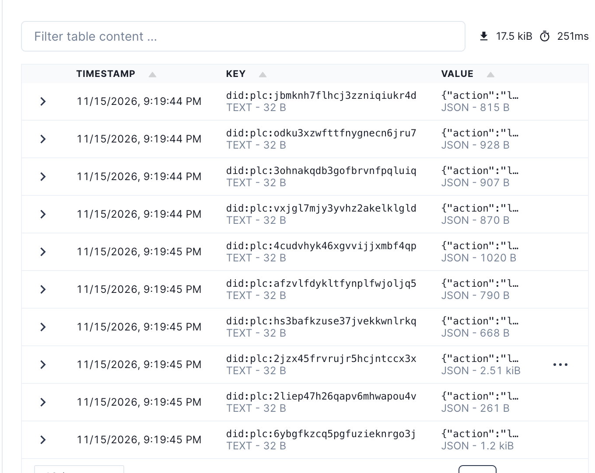
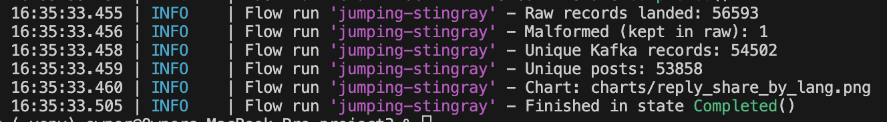
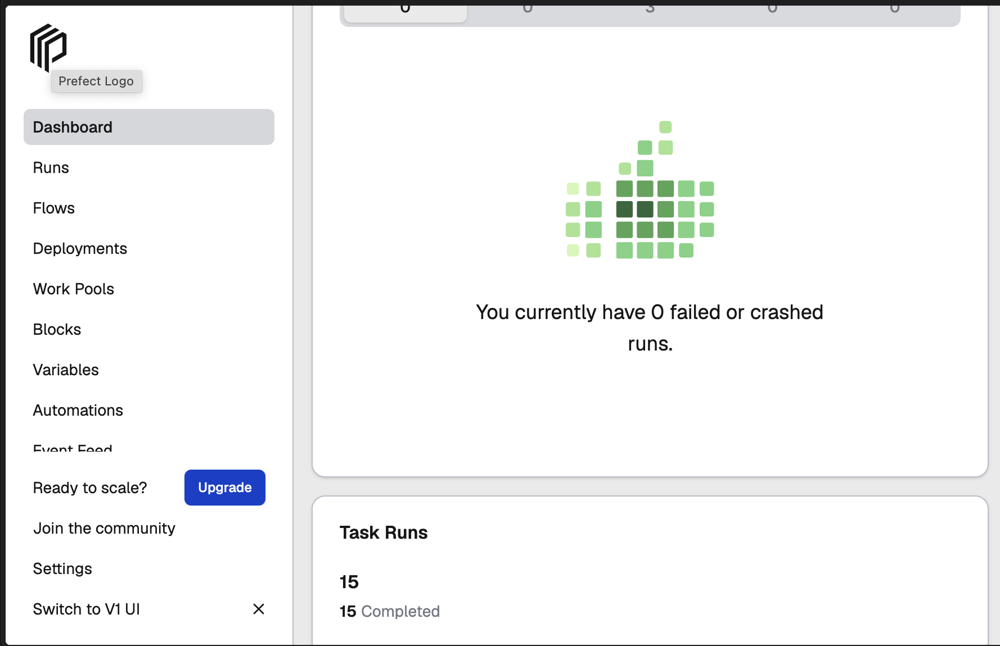
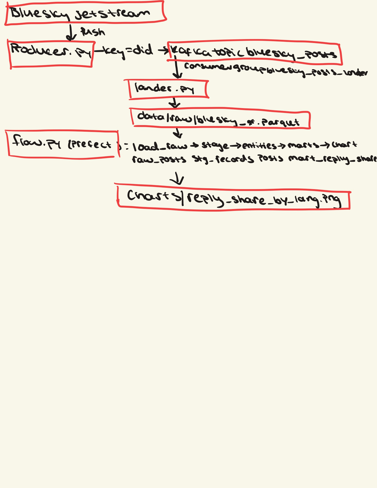
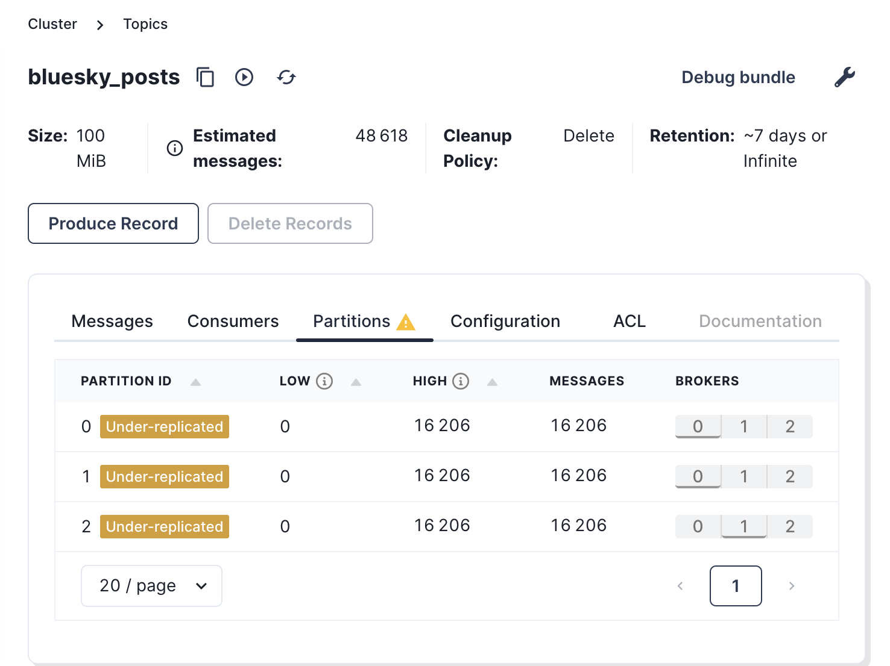

# docs/

Evidence the grader looks at. Save screenshots here (PNG or JPG) and show or link them from your README.

Required (at least these three):

1. `topic.png`: Redpanda Console (`http://127.0.0.1:8080`) showing your topic with 3 partitions and its message count (checkpoint B).

   
2. `flow_log.png`: the terminal output of your flow on the full data, with the four numbers (checkpoint E).

3. `prefect_dashboard.png`: a completed flow run in the Prefect dashboard (checkpoint E).

   
4. The architecture diagram

5. Chaos round: D3 broker down

